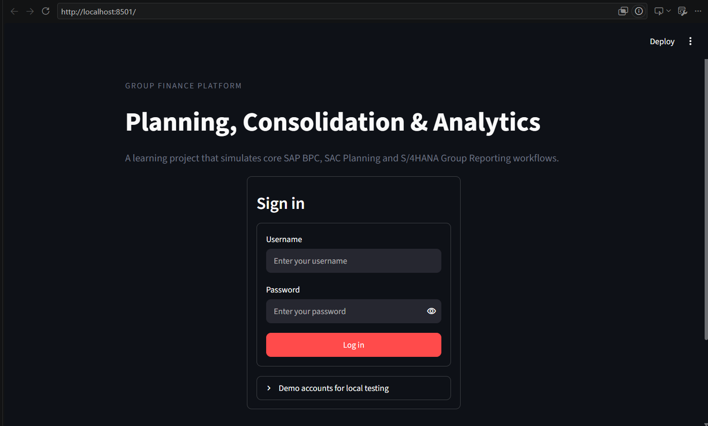
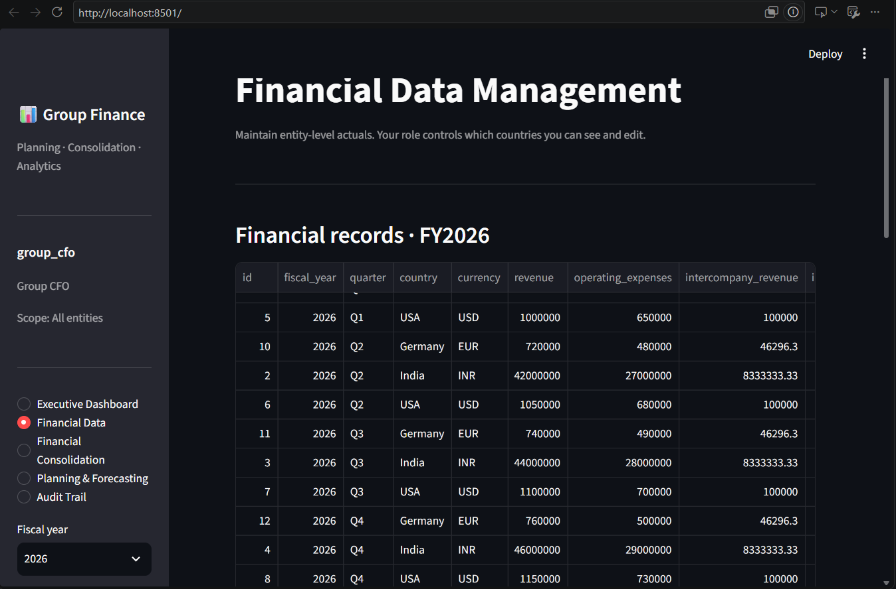
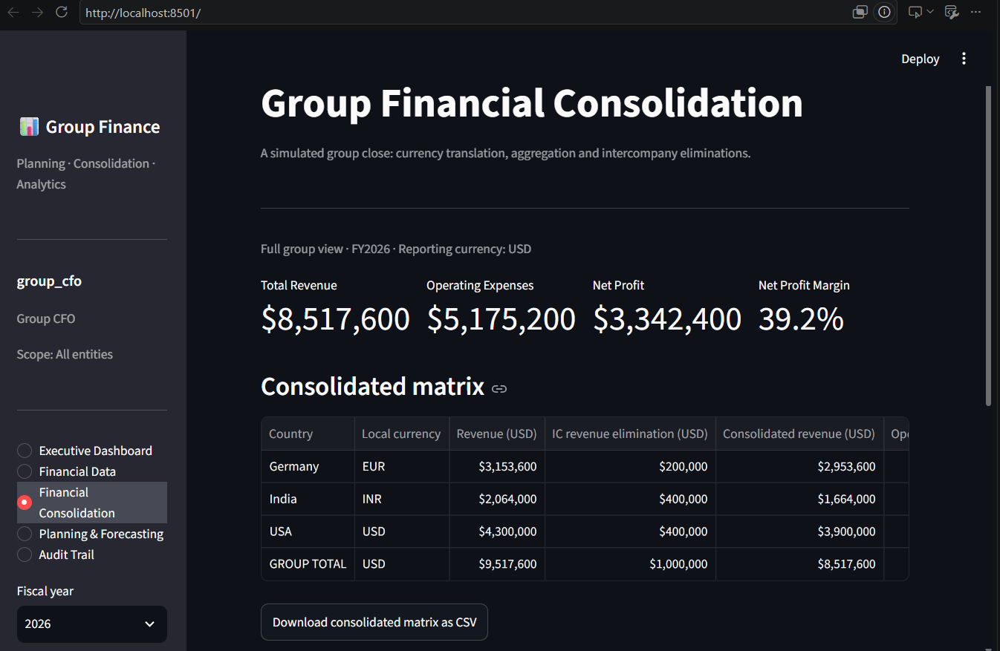
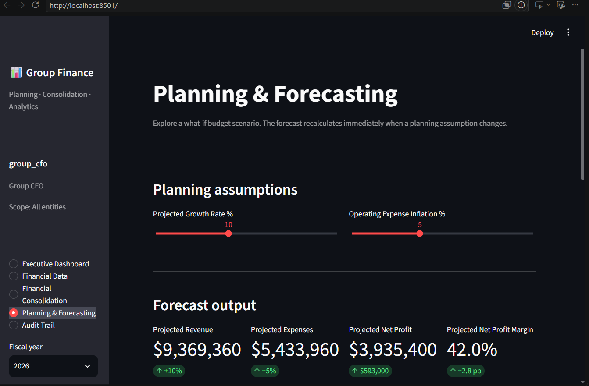
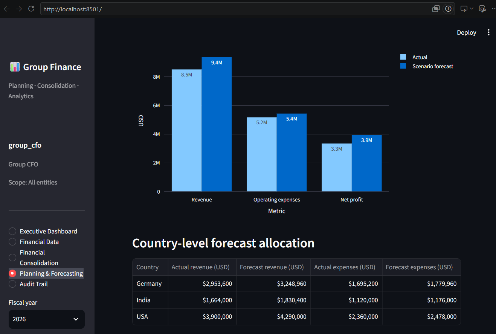

Financial Planning, Consolidation & Analytics Platform

A Python-Based Enterprise Financial Planning and Consolidation Simulation

A financial planning, consolidation, forecasting, and analytics application developed using Python and Streamlit. This project demonstrates selected business processes commonly associated with enterprise finance platforms such as SAP BPC, SAP Analytics Cloud (SAC), and SAP S/4HANA Group Reporting.

1. Project Overview

This project simulates the financial planning, reporting, and consolidation processes of a fictional multinational company operating across:

India

United States

Germany

Each country maintains financial information in its local currency. The application brings the financial data together, simulates currency translation and intercompany eliminations, and presents consolidated financial performance through an executive dashboard.

Note: This is an independent educational simulation built using Python. It does not connect to an actual SAP system.

2. Key Features

Role-Based Access Control

Different access levels for Group CFO, country managers, and regional controllers.

Simulated authorization based on organizational responsibilities.

Financial Data Management

Manage financial records across business entities.

Work with revenue, expenses, budgets, and actual financial figures.

Store financial information using SQLite.

Currency Translation

Convert financial figures from INR, USD, and EUR into a common reporting currency.

Use configurable exchange-rate assumptions.

Financial Consolidation

Combine financial information from multiple entities.

Simulate consolidated financial reporting.

Demonstrate intercompany transaction eliminations.

Financial Planning & Forecasting

Adjust revenue growth assumptions.

Modify operating expense inflation assumptions.

Calculate projected financial performance.

Executive Dashboard

Total revenue

Operating expenses

Net profit

Net profit margin

Financial charts and visualizations

3. Application Screenshots

Login Page
 Login Page

Financial Data Management

Financial Consolidation

Financial Planning and Forecasting

Executive Dashboard

4. Technology Stack

Technology

Purpose

Python

Application development and financial calculations

Streamlit

Interactive web application

SQLite

Database management

Pandas

Financial data manipulation

NumPy

Numerical calculations

Plotly

Interactive charts and visualizations

Git & GitHub

Version control and project hosting

5. Project Architecture

financial_consolidation_project/
│
├── app.py
├── config.py
├── database/
│   └── db.py
├── data/
├── services/
│   ├── auth.py
│   ├── finance.py
│   ├── consolidation.py
│   └── forecast.py
├── tests/
├── screenshots/
├── requirements.txt
└── README.md

Important Components

Component

Responsibility

app.py

Main Streamlit application

config.py

Application configuration

database/db.py

Database initialization and operations

services/auth.py

Authentication and authorization

services/finance.py

Financial data management

services/consolidation.py

Consolidation and currency translation

services/forecast.py

Forecast calculations

screenshots/

Application screenshots

6. How to Run the Project

Prerequisites

Python 3.x

Git

Visual Studio Code (recommended)

Step 1: Clone the Repository

git clone https://github.com/Addp4002/financial-consolidation-system.git

Step 2: Navigate to the Project Folder

cd financial-consolidation-system

If the repository contains a nested project directory, enter the directory containing app.py.

Step 3: Create a Virtual Environment

python -m venv .venv

Step 4: Activate the Virtual Environment

Windows PowerShell:

.\.venv\Scripts\Activate.ps1

Step 5: Install Dependencies

pip install -r requirements.txt

Step 6: Run the Application

streamlit run app.py

Open the application in your browser:

http://localhost:8501

7. Business Process Demonstration

The project demonstrates a simplified enterprise financial workflow:

Financial information is maintained for individual entities.

Local currency amounts are translated into the reporting currency.

Financial information from multiple entities is combined.

Intercompany transactions are simulated and eliminated.

Forecast assumptions are adjusted to evaluate projected performance.

Consolidated results are presented through an executive dashboard.

8. Relevance to SAP Finance Technologies

The following table illustrates the conceptual relationship between the project modules and SAP enterprise finance solutions.

Project Module

Related SAP Technology / Concept

Financial planning and budgeting

SAP BPC / SAC Planning

Forecasting

SAP Analytics Cloud Planning

Currency translation

SAP S/4HANA Group Reporting

Financial consolidation

SAP S/4HANA Group Reporting

Intercompany eliminations

SAP S/4HANA Group Reporting

Executive analytics

SAP Analytics Cloud Stories

Role-based access

SAP authorization concepts

These are conceptual learning mappings. The project does not implement actual SAP integrations.

9. Learning Outcomes

Understanding financial planning and budgeting processes.

Understanding financial consolidation across multiple entities.

Learning currency translation concepts.

Understanding intercompany reconciliation and eliminations.

Implementing basic financial forecasting.

Working with role-based access control.

Using SQLite for structured data storage.

Processing financial datasets using Pandas and NumPy.

Developing interactive dashboards using Streamlit and Plotly.

Organizing a Python application into modular components.

10. Future Enhancements

Actual versus budget variance analysis.

Historical exchange-rate management.

More detailed financial statements.

Advanced forecasting models.

Audit logs and enhanced access controls.

Integration with SAP systems through authorized APIs.

Cloud deployment.

11. Disclaimer

This project is developed for educational and demonstration purposes. It simulates selected financial planning, consolidation, and reporting workflows using Python. It is not an official SAP product and does not connect to SAP BPC, SAP Analytics Cloud, or SAP S/4HANA.

All financial data and exchange-rate assumptions are illustrative.

Author

GitHub: Addp4002

Project Repository: Financial Consolidation System
